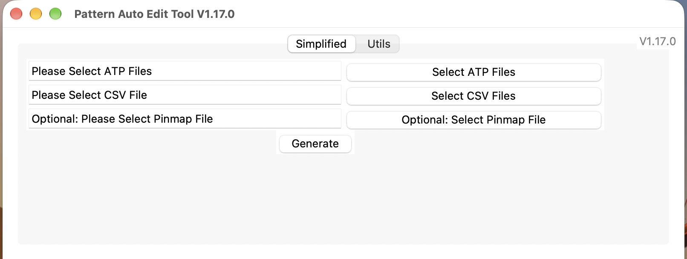

# EditPat
Tool to edit ATP pattern file for DSSC/CMEM/HRAM.

How to use：
1. Prepare the config CSV file — see [Config file format](#config-file-format) below;

	
2. Choose the ATP file, config file, Pin Name(single pin support only), edit method and time mode;	
	
3. Feature support:
	* DigCap/DigSrc;
	* HRAM/CMEM;
	* Expand Repeat(remove "repeat N" and "repeat cX"); "Expand Pattern" is the old name of the same mode and will be dropped in a future version;
	* Expand Loop(flatten "loop"/"end_loop" in srm_vector modules, which then become vm_vector);
	* Counters loaded by the test program: give their values in User String — see [Counters loaded by the test program](#counters-loaded-by-the-test-program);
	* Compress Pattern(add "repeat");

## Command line

The PyPI package ships the CLI only. Install it with Python 3.10 or newer:

```bash
pip install patautoedit
```

From a repo checkout, `pip install -e .` gives the same command, and
`python -m patautoedit` works without installing.

```bash
patautoedit run config.csv --atp-dir Sample
patautoedit run config.csv --atp-dir Sample --output-dir out/run1 --json
patautoedit check config.csv --atp-dir Sample
patautoedit modes
```

- `run` applies the config. Edited files go to `Output/` under the current
  directory unless `--output-dir` is given.
- `check` validates the config and prints what would run. It writes nothing.
- `modes` lists the Process Types and the fields each one needs.
- `--json` prints one JSON object on stdout; log lines go to stderr. Exit
  codes: `0` success, `1` a rejected config, a failed file, or no matched file,
  `2` usage error.
- `--atp-dir` defaults to the config file's folder. `--atp FILE` (repeatable)
  names candidate files explicitly and overrides `--atp-dir`.
- A `Pattern` that matches no candidate file is a warning and a skip, not an
  error. If nothing matches at all, the run exits 1.
- The CLI uses the config CSV path: Single time mode and Cycle index. Dual-mode
  or vector-index files need the desktop app's Classical tab.

The desktop and web apps are not in the wheel; run them from a repo checkout.

## Config file format

**One row is one operation.** Rows that share the same `Pattern` form a chain and
are applied top to bottom — each step reads the output of the step above it, so a
file can be edited as many times as you need.

```csv
Instance,Pattern,Status,Process Type,Pin or Method,Cycle,User String
,Sample_ATP.atp,Done,DSSC Capture,TDO,[7-7];[12-12],
,Sample_ATP.atp,Done,DSSC Capture,PORN,[13-14],
,Sample_ATP.atp,Done,DSSC Source,TDI,[9-9],
,Sample_ATP.atp,Done,WFLAG,,[8-8],
,Sample_ATP - 1.atp,Done,DSSC Source,TDI,[7-7];[9-9],
,Sample_ATP - 1.atp,Done,DSSC Capture,TDO,[7-7];[12-12],
```

`Sample_ATP.atp` above gets four chained operations; `Sample_ATP - 1.atp` gets two.

| Column | Notes |
| --- | --- |
| `Pattern` | ATP filename. Required. |
| `Process Type` | One of: DSSC Capture, DSSC Source, CMEM/HRAM Capture, Expand Pattern, Expand Repeat, Expand Loop, Compress Pattern, WFLAG, Add Opcode, Remove Opcode. Required. |
| `Pin or Method` | Blank for modes that take no pin (`WFLAG`, `Expand Repeat`, `Expand Loop`, `Compress Pattern`). |
| `Cycle` | `[a-b];[c-d]` form. Blank for `Expand Repeat`, `Expand Loop`, `Compress Pattern`, `Remove Opcode`. |
| `User String` | The opcode text for `Add Opcode` / `Remove Opcode`. For `Expand Repeat`, `Expand Loop` and `Expand Pattern`: optional counter run counts, e.g. `c0=262144; c7=8` — see [Counters loaded by the test program](#counters-loaded-by-the-test-program). Other modes ignore it. |
| `Instance`, `Status` | Ignored. Kept for your own bookkeeping. |

Column names are matched case-insensitively and column order does not matter.
Your whole config is checked before anything runs, so a mistake is reported up
front rather than half-way through a batch.

Note: the older 9-column format, where one row held two operations, is no longer
supported. Such a file is rejected with a message showing the rows to use
instead. The screenshot above still shows the old layout and needs re-taking.

`Expand Repeat` and `Compress Pattern` always use single time mode; use the
Classical tab for dual-mode files. `Expand Loop` supports single mode only.

## Counters loaded by the test program

Some patterns run `loop cX` or `repeat cX` on a counter that the test program
(VBT) loads before the pattern starts, so the ATP has no `set cX` to read.
Give those values in `User String` on the `Expand Loop` and `Expand Repeat`
rows:

```csv
Pattern,Process Type,Pin or Method,Cycle,User String
march_full.atp,Expand Loop,,,c0=262144; c7=8; c8=4
march_full.atp,Expand Repeat,,,c0=262144; c7=8; c8=4
```

Two small samples have rows in `Sample/Sample_ATP - simple.csv`:
`Sample/expand_loop/counters_preloaded_mto.atp` takes its values from
User String, and `Sample/expand_loop/counters_set_in_atp.atp` sets its own
counters, so it needs none.

- Write `cN=run count` pairs separated by `;`: counters `c0` to `c15`,
  decimal values from 1 to 268,435,455, each counter once.
- A run count is how many times the loop or repeat runs: the `N` in
  `set cX N`. A VBT line `TheHdw.Digital.Patgen.Counter(tlPgCounterN) = X`
  loads the counter register directly, so its run count is `X + 1`.
- The values act as if the VBT loaded them just before the pattern starts:
  - A `set cX` in the ATP wins from that vector on. It still needs its own
    `set_msb` first.
  - A counter the mode needs, with no value and no `set`, fails the file.
  - Values the mode does not need are ignored, with one info line in the log,
    so the same string can go on every Expand row.
- The tool never reads the test program
  ([why](doc/adr/0001-counter-values-from-the-user.md)). When one pattern runs
  with different values, for example under two test instances, make one
  renamed copy of the ATP for each set of values; each copy gets its own rows.

The words used here are defined in [GLOSSARY.md](GLOSSARY.md).

## MTO patterns

`Expand Loop` keeps the `(mto = …)` lines on every copy, but IG-XL does not
allow MTO microcode in a `vm_vector` module, so the output cannot be compiled.
It is input for a tool that generates the MTO data, and `Expand Loop` logs a
warning saying so ([why](doc/adr/0002-expanded-mto-patterns-are-not-compiled.md)).

`Expand Repeat` keeps an `srm_vector` module in SRM. To run on the tester, the
expanded module must still fit in SRM, which holds about 1,000 vectors.
